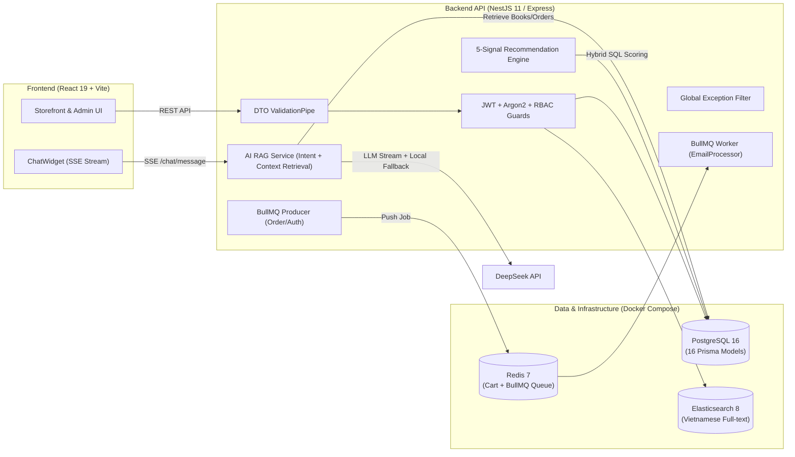

# Kế Hoạch Nâng Cấp Dự Án BookShop 2026 — Báo Cáo Cuối Kỳ Môn Lập Trình Web Nâng Cao

## 1. Tổng Quan & Đánh Giá Hiện Trạng (Gap Analysis)

Qua khảo sát toàn bộ mã nguồn [`Project-BookShop-2026-main`](file:///c:/Users/Minh/Documents/GitHub/web-bookstore/Project-BookShop-2026-main/README.md) và báo cáo đồ án cũ [`CSE703014_Report.pdf`](file:///c:/Users/Minh/Documents/GitHub/web-bookstore/Project-BookShop-2026-main/docs/CSE703014_Report.pdf), dự án hiện tại có **nền tảng tính năng rất mạnh** và hoàn toàn tương thích với yêu cầu môn **Lập trình Web nâng cao**:
- **Frontend**: React 19 (Function Components, Hooks, Context API), TypeScript, Vite, TailwindCSS 4, đa ngôn ngữ (`i18next`), Dark Mode, 12 trang (Storefront + Admin Panel).
- **Backend**: NestJS 11 (trên nền Express), Prisma ORM 7 + PostgreSQL (16 models), xác thực JWT + Refresh Token + Argon2id, phân quyền RBAC (`AuthGuard`, `RolesGuard`).
- **Tính năng nâng cao sẵn có**:
  - **AI Chatbot (RAG + SSE Streaming)** dùng DeepSeek API trong [`chat.service.ts`](file:///c:/Users/Minh/Documents/GitHub/web-bookstore/Project-BookShop-2026-main/backend-bookstore/src/chat/chat.service.ts).
  - **Hybrid Recommendation Engine (5 tín hiệu)** trong [`recommendation.service.ts`](file:///c:/Users/Minh/Documents/GitHub/web-bookstore/Project-BookShop-2026-main/backend-bookstore/src/recommendation/recommendation.service.ts).
  - **Message Queue bất đồng bộ** với BullMQ + Redis trong [`email.processor.ts`](file:///c:/Users/Minh/Documents/GitHub/web-bookstore/Project-BookShop-2026-main/backend-bookstore/src/email/email.processor.ts).
  - **Full-text Search** với Elasticsearch 8 (có fallback sang PostgreSQL).

Tuy nhiên, khi đối chiếu trực tiếp với **Rubric chấm điểm (100 điểm + 10 điểm cộng)** của môn *Lập trình Web nâng cao*, dự án đang tồn tại **6 lỗ hổng lớn** cần phải modify ngay:

| # | Vấn đề hiện tại trong Codebase | Hạng mục bị trừ điểm trong Rubric | Giải pháp khắc phục |
| :-: | :--- | :--- | :--- |
| **1** | **Hardcode `http://localhost:3000`** trong toàn bộ các trang Frontend ([`Home.tsx`](file:///c:/Users/Minh/Documents/GitHub/web-bookstore/Project-BookShop-2026-main/frontend-bookstore/src/pages/Home.tsx#L10), [`Login.tsx`](file:///c:/Users/Minh/Documents/GitHub/web-bookstore/Project-BookShop-2026-main/frontend-bookstore/src/pages/Login.tsx#L23), [`ChatWidget.tsx`](file:///c:/Users/Minh/Documents/GitHub/web-bookstore/Project-BookShop-2026-main/frontend-bookstore/src/components/ChatWidget.tsx#L7)...) và hardcode CORS ở [`main.ts`](file:///c:/Users/Minh/Documents/GitHub/web-bookstore/Project-BookShop-2026-main/backend-bookstore/src/main.ts#L17). | **Chức năng & Demo (25đ) + Deploy (10đ)**: Không thể chạy trên bản deploy Internet (Vercel/Render/Railway). | Tạo module `src/config/api.ts` đọc biến môi trường `VITE_API_URL`, thay thế toàn bộ URL cứng và mở rộng CORS động theo `FRONTEND_URL`. |
| **2** | **Các file DTO đang để rỗng** ([`create-user.dto.ts`](file:///c:/Users/Minh/Documents/GitHub/web-bookstore/Project-BookShop-2026-main/backend-bookstore/src/users/dto/create-user.dto.ts), [`create-book.dto.ts`](file:///c:/Users/Minh/Documents/GitHub/web-bookstore/Project-BookShop-2026-main/backend-bookstore/src/books/dto/create-book.dto.ts), [`create-order.dto.ts`](file:///c:/Users/Minh/Documents/GitHub/web-bookstore/Project-BookShop-2026-main/backend-bookstore/src/orders/dto/create-order.dto.ts)) và Controller nhận `@Body() body: any`. | **Bảo mật & Validate (15đ) + Demo lỗi (25đ) + Live code 3 phút (20đ)**: `ValidationPipe` không hoạt động nếu dùng interface/any. | Viết đầy đủ các class DTO với decorators `class-validator` (`@IsEmail`, `@MinLength`, `@IsNumber`, `@Min`...) và gắn vào Controller. |
| **3** | **Thiếu xử lý lỗi tập trung (Centralized Error Handling)** ở Backend. | **Kiến trúc & Chất lượng code (20đ)**: Rubric mức Tốt yêu cầu rõ *"xử lý lỗi tập trung"*. | Xây dựng `AllExceptionsFilter` chuẩn hóa JSON lỗi trả về (bắt cả `HttpException` và lỗi Prisma `P2002`, `P2025`). |
| **4** | **Chưa có GitHub Actions CI** và chưa chạy được toàn bộ hệ thống bằng **1 lệnh duy nhất**. | **Kiểm thử & CI (15đ) + Sản phẩm nộp (10đ)**: Bắt buộc CI chạy xanh và README chạy bằng 1 lệnh (`docker compose up` hoặc `npm install && npm run dev`). | Thêm `.github/workflows/ci.yml`, thêm `Dockerfile` cho Backend/Frontend vào `docker-compose.yml` và thêm `package.json` gốc chạy 1 lệnh. |
| **5** | **Chưa có số liệu đánh giá định lượng cho AI (Chatbot RAG & Recommendation)**. | **Điểm cộng (+10đ) & Trình bày Chất lượng (10đ)**: Yêu cầu *"tích hợp mô hình AI có số liệu đánh giá"*. | Viết script benchmark tự động (`npm run ai:evaluate`) đo Accuracy phân loại ý định, Hit Rate@5 của RAG, Latency & Coverage. |
| **6** | **Báo cáo cũ dài 90 trang (làm 1 người)**, thừa các file script nháp (`check-db.js`, `delete-books.js`). | **Báo cáo PDF yêu cầu 5–8 trang**, nhóm **4 thành viên** đều phải có commit, bảng phân công và phần hỏi đáp riêng. | Biên soạn lại Báo cáo 5–8 trang khớp 100% rubric, dọn file rác, chia rõ 4 gói công việc theo module & kịch bản live-code 3 phút (1 người thực hiện toàn bộ: Dương Công Minh — 22010009). |

---

## 2. Chiến Lược Tối Đa Hóa Điểm Cộng (+10 Điểm)

Dự án của bạn có lợi thế rất lớn là đã cài sẵn các công nghệ nâng cao. Thay vì viết mới từ đầu, chúng ta sẽ **chuẩn hóa và đóng gói 4 hạng mục điểm cộng** sau để tạo ấn tượng tuyệt đối với giảng viên:



1. **Tích hợp AI (Chatbot RAG + Hybrid Recommendation) kèm Số liệu Đánh giá (+Điểm cộng chủ lực)**:
   - Nâng cấp [`ChatService`](file:///c:/Users/Minh/Documents/GitHub/web-bookstore/Project-BookShop-2026-main/backend-bookstore/src/chat/chat.service.ts): Tách từ khóa thông minh hơn (hỗ trợ tìm theo tên sách, tác giả, thể loại, khoảng giá) và bổ sung **chế độ Fallback thông minh** (nếu trên môi trường chấm thi không có `DEEPSEEK_API_KEY` hoặc đứt mạng quốc tế, Chatbot vẫn tự động tổng hợp câu trả lời tư vấn từ dữ liệu RAG truy xuất được trong PostgreSQL thay vì báo lỗi chết).
   - Tạo bộ đánh giá tự động `scripts/evaluate-ai.ts` xuất bảng thống kê: **Intent Accuracy (%)**, **Retrieval Hit Rate@5 (%)**, **Precision@3 (%)**, và **Thời gian phản hồi trung bình (ms)**.
2. **Message Queue với Redis & BullMQ (+Điểm cộng kiến trúc)**:
   - Làm nổi bật luồng bất đồng bộ khi Đăng ký (`welcome-email`) và Đặt hàng (`invoice-email`) qua Redis Queue giúp API `/orders/checkout` phản hồi tức thì mà không bị block bởi SMTP server.
3. **Docker Compose Toàn Diện & One-Command Run (+Điểm cộng DevOps)**:
   - Bổ sung `Dockerfile` cho `backend-bookstore` và `frontend-bookstore`, tích hợp vào `docker-compose.yml` để chạy toàn bộ bằng 1 lệnh `docker compose up --build`, đồng thời tạo `package.json` ở thư mục gốc hỗ trợ `npm install && npm run dev`.
4. **GitHub Actions CI (+Điểm cộng Chất lượng)**:
   - Tự động chạy Linter, kiểm tra TypeScript build, chạy Unit Test & Integration Test (`.e2e-spec.ts`) kèm báo cáo Coverage mỗi khi push code.

---

## 3. Phân Công Nhiệm Vụ (Thực hiện độc lập — 1 người)

> Do bất đồng quan điểm trong nhóm, toàn bộ dự án hiện do một mình **Dương Công Minh (22010009)** thực hiện. 4 gói công việc dưới đây được giữ làm phân tách theo module để ôn tập hỏi đáp.

> [!IMPORTANT]
> Theo mục 4 & 5 của hướng dẫn: **Mỗi thành viên phải commit bằng tài khoản GitHub của mình** và **chịu trách nhiệm giải thích + sửa code trực tiếp trong 3 phút** trên phần mình phụ trách. Dưới đây là phương án chia 4 gói công việc (mỗi gói ~25% khối lượng) cực kỳ cân bằng và rõ ranh giới code:

| Gói công việc | Vai trò & Module phụ trách (~25% khối lượng) | File / Thư mục chính (Dùng để commit & ôn hỏi đáp) | Kịch bản sửa code tại chỗ trong 3 phút (Live Coding) |
| :--- | :--- | :--- | :--- |
| **Gói 1** | **Kiến trúc, Search, AI RAG Chatbot & Recommendation** | `src/chat/`, `src/search/`, `src/recommendation/`, `src/common/filters/`, `ChatWidget.tsx`, `Search.tsx`, Docker & CI | Thêm 1 intent mới vào `ChatService` (ví dụ: hỏi mã giảm giá/chính sách đổi trả) + viết 1 unit test cho intent đó. |
| **Gói 2** | **Xác thực (Auth), Người dùng (Users), Phân quyền & Bảo mật** | `src/auth/`, `src/users/`, `Login.tsx`, `Register.tsx`, `Account.tsx`, `AuthContext.tsx`, `auth.service.spec.ts`, `auth.e2e-spec.ts` | Thêm validation cho `RegisterDto` (ví dụ: kiểm tra định dạng số điện thoại Việt Nam `@Matches(/^(0|\+84)[0-9]{9}$/)`) hoặc thêm trường vào profile. |
| **Gói 3** | **Catalog Sách, Danh mục, Đánh giá (Reviews) & Admin Panel** | `src/books/`, `src/categories/`, `src/reviews/`, `src/admin/`, `src/upload/`, `Home.tsx`, `BookDetail.tsx`, `Admin.tsx`, `books.e2e-spec.ts` | Thêm 1 trường hoặc validation vào `CreateBookDto` (ví dụ: `discount_percent` từ `0–100` hoặc chặn `price < 0`) và test trên API. |
| **Gói 4** | **Giỏ hàng (Redis Cart), Đặt hàng (Orders), Thanh toán & Email Queue** | `src/cart/`, `src/orders/`, `src/payment/`, `src/email/`, `Cart.tsx`, `Checkout.tsx`, `PaymentResult.tsx`, `CartContext.tsx`, `orders.service.spec.ts` | Thêm validation cho `CheckoutDto` (ví dụ: đơn hàng tối thiểu hoặc kiểm tra số lượng mua tối đa mỗi lần) + 1 unit test trong `orders.service.spec.ts`. |

---

## 4. Câu Hỏi Cần Bạn Xác Nhận Trước Khi Thực Thi (Open Questions)

> [!NOTE]
> Bạn vui lòng xem qua và xác nhận giúp mình các điểm sau để khi bạn bấm **Proceed**, mình có thể triển khai chính xác 100%:
> 1. **Cấu trúc thư mục gốc của Git Repo**: Hiện tại thư mục `Project-BookShop-2026-main` đang nằm bên trong `c:\Users\Minh\Documents\GitHub\web-bookstore\Project-BookShop-2026-main`. Bạn muốn mình **chuyển toàn bộ các file ra thẳng thư mục gốc `web-bookstore`** (để khi giảng viên clone repo về chạy lệnh ngay tại root theo đúng chuẩn), hay giữ nguyên trong `Project-BookShop-2026-main`? *(Khuyên dùng: Đưa ra thẳng thư mục gốc của repo hoặc tạo script ủy quyền ở root)*.
> 2. **Danh sách tên & MSSV của các thành viên**: **Đã chốt: dự án thực hiện độc lập bởi Dương Công Minh (22010009)** — báo cáo và bảng phân công ghi 1 người.
> 3. **Nền tảng Deploy dự kiến**: Bạn dự định deploy lên đâu (ví dụ: **Vercel** cho Frontend + **Render / Railway** cho Backend & PostgreSQL/Redis)? Mình sẽ tạo sẵn file cấu hình `vercel.json` và `render.yaml` / `railway.json` tương ứng.

---

## 5. Chi Tiết Các Thay Đổi Đề Xuất (Proposed Changes)

### Component 1: Chuẩn Hóa Cấu Trúc, One-Command Run & Docker Compose Full-Stack

Đảm bảo bất kỳ ai clone repo về đều có thể chạy dự án bằng **1 lệnh duy nhất** (`npm install && npm run dev` hoặc `docker compose up`) theo đúng yêu cầu tại Mục 2 của hướng dẫn.

#### [NEW] [package.json](file:///c:/Users/Minh/Documents/GitHub/web-bookstore/Project-BookShop-2026-main/package.json)
Tạo `package.json` ở thư mục gốc của dự án kết hợp `concurrently` để cài đặt và chạy cả Backend + Frontend bằng một lệnh:
```json
{
  "name": "project-bookshop-2026",
  "version": "1.0.0",
  "private": true,
  "scripts": {
    "postinstall": "npm --prefix backend-bookstore install && npm --prefix frontend-bookstore install",
    "dev": "concurrently -n \"BACKEND,FRONTEND\" -c \"blue,magenta\" \"npm --prefix backend-bookstore run start:dev\" \"npm --prefix frontend-bookstore run dev\"",
    "build": "npm --prefix backend-bookstore run build && npm --prefix frontend-bookstore run build",
    "test": "npm --prefix backend-bookstore test && npm --prefix backend-bookstore run test:e2e",
    "ai:evaluate": "npm --prefix backend-bookstore run ai:evaluate",
    "docker:up": "docker compose up -d"
  },
  "devDependencies": {
    "concurrently": "^9.1.2"
  }
}
```

#### [NEW] [backend-bookstore/Dockerfile](file:///c:/Users/Minh/Documents/GitHub/web-bookstore/Project-BookShop-2026-main/backend-bookstore/Dockerfile) & [frontend-bookstore/Dockerfile](file:///c:/Users/Minh/Documents/GitHub/web-bookstore/Project-BookShop-2026-main/frontend-bookstore/Dockerfile)
Tạo `Dockerfile` chuẩn multi-stage cho cả Backend (NestJS + Prisma) và Frontend (Vite/React).

#### [MODIFY] [docker-compose.yml](file:///c:/Users/Minh/Documents/GitHub/web-bookstore/Project-BookShop-2026-main/docker-compose.yml)
Đồng bộ cổng PostgreSQL (`5433:5432`) khớp với `.env.example`, bổ sung service `backend` và `frontend` vào `docker-compose.yml` чтобы lệnh `docker compose up` khởi chạy toàn bộ hệ thống.

#### [DELETE] Các file script nháp trong `backend-bookstore/`
- Xoá [`check-db.js`](file:///c:/Users/Minh/Documents/GitHub/web-bookstore/Project-BookShop-2026-main/backend-bookstore/check-db.js)
- Xoá [`delete-all-books.ts`](file:///c:/Users/Minh/Documents/GitHub/web-bookstore/Project-BookShop-2026-main/backend-bookstore/delete-all-books.ts)
- Xoá [`delete-books.js`](file:///c:/Users/Minh/Documents/GitHub/web-bookstore/Project-BookShop-2026-main/backend-bookstore/delete-books.js)

---

### Component 2: Khắc Phục Hardcode URL Ở Frontend & Hỗ Trợ Deploy Thực Tế

#### [NEW] [frontend-bookstore/src/config/api.ts](file:///c:/Users/Minh/Documents/GitHub/web-bookstore/Project-BookShop-2026-main/frontend-bookstore/src/config/api.ts)
```typescript
export const API_BASE_URL =
  import.meta.env.VITE_API_URL?.replace(/\/+$/, '') || 'http://localhost:3000';
```

#### [NEW] [frontend-bookstore/.env.example](file:///c:/Users/Minh/Documents/GitHub/web-bookstore/Project-BookShop-2026-main/frontend-bookstore/.env.example)
```env
VITE_API_URL="http://localhost:3000"
```

#### [MODIFY] Toàn bộ các trang và component gọi API trong `frontend-bookstore/src/`
Thay thế chuỗi cứng `'http://localhost:3000'` bằng `API_BASE_URL` từ `src/config/api.ts` tại:
- [`src/context/CartContext.tsx`](file:///c:/Users/Minh/Documents/GitHub/web-bookstore/Project-BookShop-2026-main/frontend-bookstore/src/context/CartContext.tsx)
- [`src/components/ChatWidget.tsx`](file:///c:/Users/Minh/Documents/GitHub/web-bookstore/Project-BookShop-2026-main/frontend-bookstore/src/components/ChatWidget.tsx)
- [`src/components/Header.tsx`](file:///c:/Users/Minh/Documents/GitHub/web-bookstore/Project-BookShop-2026-main/frontend-bookstore/src/components/Header.tsx)
- [`src/components/PromoBanner.tsx`](file:///c:/Users/Minh/Documents/GitHub/web-bookstore/Project-BookShop-2026-main/frontend-bookstore/src/components/PromoBanner.tsx)
- [`src/pages/Home.tsx`](file:///c:/Users/Minh/Documents/GitHub/web-bookstore/Project-BookShop-2026-main/frontend-bookstore/src/pages/Home.tsx), [`Login.tsx`](file:///c:/Users/Minh/Documents/GitHub/web-bookstore/Project-BookShop-2026-main/frontend-bookstore/src/pages/Login.tsx), [`Register.tsx`](file:///c:/Users/Minh/Documents/GitHub/web-bookstore/Project-BookShop-2026-main/frontend-bookstore/src/pages/Register.tsx), [`Search.tsx`](file:///c:/Users/Minh/Documents/GitHub/web-bookstore/Project-BookShop-2026-main/frontend-bookstore/src/pages/Search.tsx), [`BookDetail.tsx`](file:///c:/Users/Minh/Documents/GitHub/web-bookstore/Project-BookShop-2026-main/frontend-bookstore/src/pages/BookDetail.tsx), [`Cart.tsx`](file:///c:/Users/Minh/Documents/GitHub/web-bookstore/Project-BookShop-2026-main/frontend-bookstore/src/pages/Cart.tsx), [`Checkout.tsx`](file:///c:/Users/Minh/Documents/GitHub/web-bookstore/Project-BookShop-2026-main/frontend-bookstore/src/pages/Checkout.tsx), [`Account.tsx`](file:///c:/Users/Minh/Documents/GitHub/web-bookstore/Project-BookShop-2026-main/frontend-bookstore/src/pages/Account.tsx), [`Admin.tsx`](file:///c:/Users/Minh/Documents/GitHub/web-bookstore/Project-BookShop-2026-main/frontend-bookstore/src/pages/Admin.tsx), [`NewBooks.tsx`](file:///c:/Users/Minh/Documents/GitHub/web-bookstore/Project-BookShop-2026-main/frontend-bookstore/src/pages/NewBooks.tsx), [`BestSellers.tsx`](file:///c:/Users/Minh/Documents/GitHub/web-bookstore/Project-BookShop-2026-main/frontend-bookstore/src/pages/BestSellers.tsx), [`PaymentResult.tsx`](file:///c:/Users/Minh/Documents/GitHub/web-bookstore/Project-BookShop-2026-main/frontend-bookstore/src/pages/PaymentResult.tsx).

#### [NEW] [frontend-bookstore/vercel.json](file:///c:/Users/Minh/Documents/GitHub/web-bookstore/Project-BookShop-2026-main/frontend-bookstore/vercel.json)
Cấu hình SPA fallback (`rewrites` về `/index.html`) để khi deploy lên Vercel không bị lỗi `404 Not Found` khi F5 các route như `/book/:id`, `/admin`, `/cart`.

---

### Component 3: Xử Lý Lỗi Tập Trung (Centralized Error Handling) & DTO Validation Chuẩn

#### [NEW] [backend-bookstore/src/common/filters/all-exceptions.filter.ts](file:///c:/Users/Minh/Documents/GitHub/web-bookstore/Project-BookShop-2026-main/backend-bookstore/src/common/filters/all-exceptions.filter.ts)
Middleware/Filter xử lý lỗi tập trung cho toàn bộ Backend:
- Chuẩn hóa mọi phản hồi lỗi về cấu trúc thống nhất:
  ```json
  {
    "statusCode": 400,
    "error": "Bad Request",
    "message": "Giá sách không được nhỏ hơn 0",
    "path": "/books",
    "timestamp": "2026-10-21T09:30:00.000Z"
  }
  ```
- Tự động dịch các mã lỗi Prisma (`P2002` trùng khóa duy nhất sang `409 Conflict`, `P2025` không tìm thấy bản ghi sang `404 Not Found`).

#### [MODIFY] [backend-bookstore/src/main.ts](file:///c:/Users/Minh/Documents/GitHub/web-bookstore/Project-BookShop-2026-main/backend-bookstore/src/main.ts)
- Đăng ký `app.useGlobalFilters(new AllExceptionsFilter())`.
- Cấu hình CORS đọc danh sách origin từ `process.env.FRONTEND_URL` (hỗ trợ cả localhost và domain deploy).
- Thêm endpoint `/health` kiểm tra trạng thái hệ thống phục vụ Cloud Deploy & CI.

#### [MODIFY] Các file DTO & Controller trong `backend-bookstore/src/`
Bổ sung validation decorators (`class-validator`, `class-transformer`) cho:
- [`src/auth/dto/login.dto.ts`](file:///c:/Users/Minh/Documents/GitHub/web-bookstore/Project-BookShop-2026-main/backend-bookstore/src/auth/dto/login.dto.ts) (`[NEW]`): `@IsEmail()`, `@IsString()`, `@MinLength(6)`.
- [`src/users/dto/create-user.dto.ts`](file:///c:/Users/Minh/Documents/GitHub/web-bookstore/Project-BookShop-2026-main/backend-bookstore/src/users/dto/create-user.dto.ts): Validate `email`, `password_raw` ($\ge 6$ ký tự), `full_name`.
- [`src/books/dto/create-book.dto.ts`](file:///c:/Users/Minh/Documents/GitHub/web-bookstore/Project-BookShop-2026-main/backend-bookstore/src/books/dto/create-book.dto.ts) & [`update-book.dto.ts`](file:///c:/Users/Minh/Documents/GitHub/web-bookstore/Project-BookShop-2026-main/backend-bookstore/src/books/dto/update-book.dto.ts): Validate `title` (`@IsNotEmpty()`), `price` (`@IsNumber()`, `@Min(0)`), `stock_qty` (`@IsInt()`, `@Min(0)`).
- [`src/orders/dto/create-order.dto.ts`](file:///c:/Users/Minh/Documents/GitHub/web-bookstore/Project-BookShop-2026-main/backend-bookstore/src/orders/dto/create-order.dto.ts): Validate `payment_method` (`@IsIn(['cod', 'bank_transfer', 'momo', 'vnpay', 'payos'])`), `shipping_address` (`@IsObject()`, `@IsNotEmptyObject()`).
- Gắn các DTO này vào [`AuthController`](file:///c:/Users/Minh/Documents/GitHub/web-bookstore/Project-BookShop-2026-main/backend-bookstore/src/auth/auth.controller.ts), [`UsersController`](file:///c:/Users/Minh/Documents/GitHub/web-bookstore/Project-BookShop-2026-main/backend-bookstore/src/users/users.controller.ts), [`BooksController`](file:///c:/Users/Minh/Documents/GitHub/web-bookstore/Project-BookShop-2026-main/backend-bookstore/src/books/books.controller.ts), [`OrdersController`](file:///c:/Users/Minh/Documents/GitHub/web-bookstore/Project-BookShop-2026-main/backend-bookstore/src/orders/orders.controller.ts).

---

### Component 4: Nâng Cấp AI Chatbot RAG, Script Đánh Giá Mô Hình & Kiểm Thử + CI

#### [MODIFY] [backend-bookstore/src/chat/chat.service.ts](file:///c:/Users/Minh/Documents/GitHub/web-bookstore/Project-BookShop-2026-main/backend-bookstore/src/chat/chat.service.ts)
- Cải thiện thuật toán phân loại Intent (thêm nhận diện câu hỏi về mã giảm giá/khuyến mãi & chính sách vận chuyển).
- Cải thiện hàm `buildBookSearchContext`: Tách từ khóa tiếng Việt sạch hơn, tìm kiếm trên cả `title`, `description`, `author.name`, và `category.name`.
- **Thêm cơ chế Local RAG Fallback**: Nếu chưa cấu hình `DEEPSEEK_API_KEY` hoặc API bên ngoài bị timeout khi đang demo trực tiếp trên lớp, `ChatService` tự động sinh câu trả lời Markdown chuẩn dựa trên context truy xuất từ Database (có đầy đủ tên sách, giá tiền, số sao và link `[Xem chi tiết](/book/ID)`), đảm bảo **demo 100% không bao giờ lỗi**.

#### [NEW] [backend-bookstore/scripts/evaluate-ai.ts](file:///c:/Users/Minh/Documents/GitHub/web-bookstore/Project-BookShop-2026-main/backend-bookstore/scripts/evaluate-ai.ts)
Script chạy benchmark đánh giá chất lượng mô hình AI (`npm run ai:evaluate`):
- Bộ test gồm **40 câu truy vấn chuẩn** thuộc 4 nhóm intent (`book_search`, `order_tracking`, `recommendation`, `general`).
- Tính toán tự động và in ra bảng **Precision, Recall, F1-Score, Accuracy** cho bộ phân loại Intent + **Retrieval Hit Rate@5 & Latency (ms)** cho RAG Context Builder & Recommendation Engine.

#### [NEW] [backend-bookstore/src/chat/chat.service.spec.ts](file:///c:/Users/Minh/Documents/GitHub/web-bookstore/Project-BookShop-2026-main/backend-bookstore/src/chat/chat.service.spec.ts) & [backend-bookstore/src/common/filters/all-exceptions.filter.spec.ts](file:///c:/Users/Minh/Documents/GitHub/web-bookstore/Project-BookShop-2026-main/backend-bookstore/src/common/filters/all-exceptions.filter.spec.ts)
Bổ sung Unit Test cho `ChatService` (Intent classification, RAG context retrieval, fallback streaming) và `AllExceptionsFilter`.

#### [NEW] [.github/workflows/ci.yml](file:///c:/Users/Minh/Documents/GitHub/web-bookstore/.github/workflows/ci.yml)
Thiết lập GitHub Actions CI chạy tự động khi `push` hoặc `pull_request`:
1. Job `backend-test`: Cài dependencies, `npx prisma generate`, chạy **Unit Tests** (`npm test`), chạy **Integration/E2E Tests** (`npm run test:e2e`), và kiểm tra `npm run build`.
2. Job `frontend-build`: Cài dependencies, kiểm tra TypeScript & Vite build (`npm run build`).

---

### Component 5: Bộ Tài Liệu Báo Cáo Cuối Kỳ (5–8 Trang), Bảng Phân Công & Slide

Tạo mới bộ tài liệu chuẩn mực cho môn **Lập trình Web nâng cao** trong thư mục `docs/`:

#### [NEW] [docs/Bao_Cao_Cuoi_Ky_Web_Nang_Cao.md](file:///c:/Users/Minh/Documents/GitHub/web-bookstore/Project-BookShop-2026-main/docs/Bao_Cao_Cuoi_Ky_Web_Nang_Cao.md)
Báo cáo cô đọng đúng **5–8 trang A4** theo sát 7 mục bắt buộc trong hướng dẫn:
1. **Bài toán và người dùng**: Vấn đề thực tế, đối tượng mục tiêu (Customer & Admin), các chức năng chính.
2. **Kiến trúc hệ thống**: Sơ đồ kiến trúc thực tế (React 19 → NestJS REST API → PostgreSQL / Redis BullMQ / Elasticsearch / DeepSeek RAG), lý do chọn công nghệ và cách phân tầng.
3. **Danh sách API chính**: Bảng tổng hợp các RESTful endpoints theo từng phân hệ kèm cơ chế Auth/RBAC.
4. **Mô hình dữ liệu**: Sơ đồ ERD và giải thích 16 bảng trong Prisma Schema + cấu trúc lưu trữ Redis/Elasticsearch.
5. **Kiểm thử, CI và Bảo mật**: Kết quả chạy Unit Test + Integration Test (Supertest), cấu hình GitHub Actions CI, biện pháp bảo mật (Argon2id, JWT + Refresh Token, RBAC Guards, DTO Validation, `.env.example`).
6. **Đánh giá mô hình AI & Hiệu năng (Điểm cộng)**: Kiến trúc RAG Chatbot & Hybrid 5-Signal Recommendation kèm bảng số liệu thực nghiệm từ `evaluate-ai.ts` (Accuracy, F1-Score, Hit Rate@5, Latency).
7. **Hạn chế, Hướng phát triển & Khai báo sử dụng AI**: Nêu rõ các hạn chế hiện tại, hướng mở rộng (scale $10\times$), và bảng khai báo minh bạch việc sử dụng công cụ AI theo đúng Mục 4 của hướng dẫn.

#### [NEW] [docs/Bang_Phan_Cong_Va_On_Tap_Van_Dap.md](file:///c:/Users/Minh/Documents/GitHub/web-bookstore/Project-BookShop-2026-main/docs/Bang_Phan_Cong_Va_On_Tap_Van_Dap.md)
- **Bảng phân công công việc** (100% — 1 người: Dương Công Minh, 22010009, có khung chữ ký xác nhận để in/xuất PDF nộp kèm).
- **Cẩm nang hỏi đáp cá nhân (20 điểm)** cho người thực hiện (toàn bộ module):
  - Giải thích các quyết định thiết kế (vì sao dùng Argon2id, vì sao lưu giỏ hàng trên Redis, vì sao tách Email bằng BullMQ, vì sao kết hợp PostgreSQL + Elasticsearch).
  - Trả lời câu hỏi tình huống mở rộng (khi lượng user tăng $10\times$ thì nghẽn ở đâu, khi Redis/Elasticsearch/AI sập thì hệ thống fallback thế nào).
  - Hướng dẫn từng bước cho **bài kiểm tra sửa code trực tiếp trong 3 phút** của người thực hiện.

#### [NEW] [docs/Slide_Thuyet_Trinh_12_Trang_Va_Kich_Ban_Demo.md](file:///c:/Users/Minh/Documents/GitHub/web-bookstore/Project-BookShop-2026-main/docs/Slide_Thuyet_Trinh_12_Trang_Va_Kich_Ban_Demo.md)
- Nội dung chi tiết cho **12 Slide thuyết trình** do 1 người trình bày trong đúng **10 phút** (theo đúng cấu trúc thời gian: 1p Bài toán – 2p Kiến trúc – 2p Demo – 2p Kỹ thuật nổi bật – 2p Chất lượng – 1p Hạn chế).
- **Kịch bản Demo trực tiếp 2 phút** (luồng chính + kịch bản demo xử lý lỗi dữ liệu sai / chưa đăng nhập / không đủ quyền).

---

## 6. Kế Hoạch Kiểm Chứng (Verification Plan)

### Kiểm Thử Tự Động (Automated Tests)
Sau khi thực hiện các thay đổi, chạy các lệnh sau để xác nhận 100% test và build đều xanh:
```powershell
# 1. Chạy toàn bộ Unit Tests của Backend
cd backend-bookstore
npm test

# 2. Chạy toàn bộ Integration / E2E API Tests của Backend
npm run test:e2e

# 3. Chạy script đánh giá mô hình AI (xuất chỉ số Accuracy, F1, Latency)
npm run ai:evaluate

# 4. Kiểm tra build Production của cả Backend và Frontend
npm run build
cd ../frontend-bookstore
npm run build
```

### Kiểm Chứng Thủ Công (Manual Verification)
1. **Kiểm tra chạy 1 lệnh**: Chạy `npm run dev` từ thư mục gốc để xác nhận cả Backend (`http://localhost:3000`) và Frontend (`http://localhost:5173`) cùng khởi động thành công.
2. **Kiểm tra Validation & Centralized Error Handling**: Gửi request tạo sách với `price: -100` hoặc đăng nhập sai định dạng email để xác nhận `AllExceptionsFilter` + `ValidationPipe` trả về mã `400 Bad Request` với thông báo lỗi chuẩn.
3. **Kiểm tra AI Chatbot Fallback**: Thử nhắn tin trên `ChatWidget` cả khi có và không có `DEEPSEEK_API_KEY` để xác nhận SSE streaming hoạt động mượt mà.
4. **Rà soát tài liệu**: Kiểm tra lại `README.md`, Báo cáo cuối kỳ 5–8 trang và Bảng phân công công việc khớp 100% với code thực tế.
